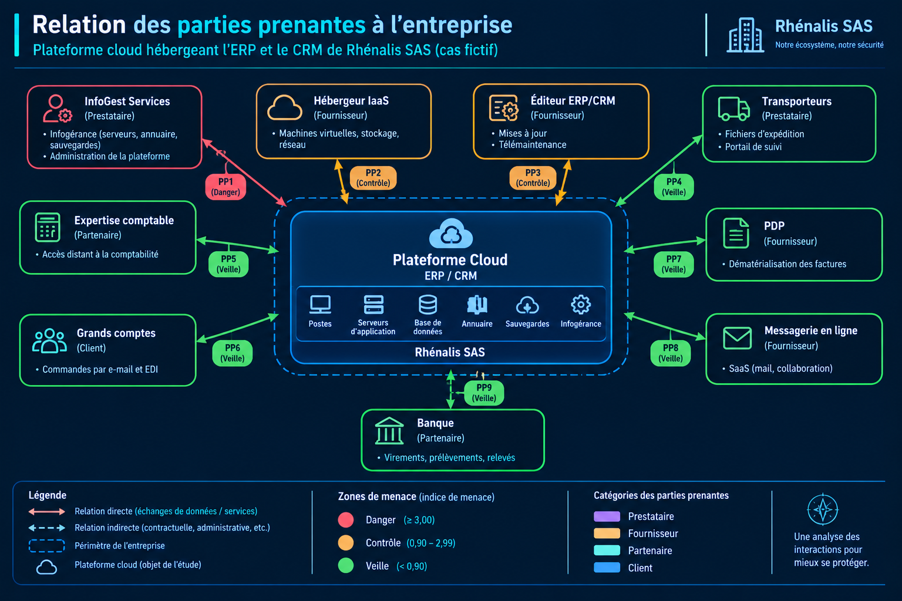
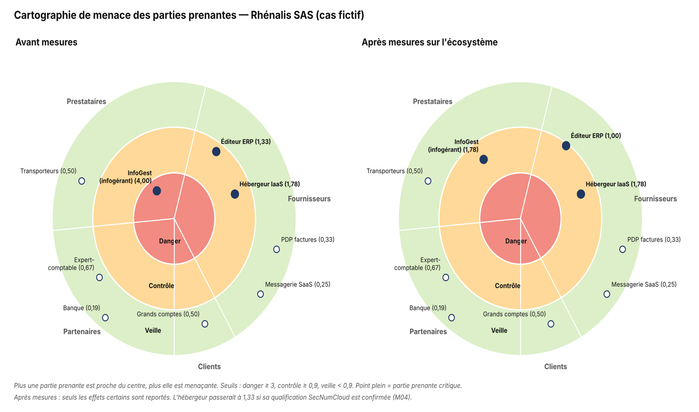

# A3 - Parties prenantes et indice de menace

> **Atelier 3 - Étape 3.1 : Écosystème et parties prenantes**  
> Feuille du classeur : `Atelier 3 - PP` (+ `Atelier 3 - Carto PP`, `datacartoPP`)  
> Dossier parent : [`README.md`](../README.md) · Fiche amont : [`02_atelier2_sources_risque/A2_couples_SR_OV.md`](../02_atelier2_sources_risque/A2_couples_SR_OV.md) · Fiche aval : [`A3_scenarios_strategiques.md`](./A3_scenarios_strategiques.md)

---

## 1. Identification

| Champ | Valeur |
|---|---|
| **Objet de l'étude** | Plateforme cloud hébergeant l'ERP et le CRM de Rhénalis SAS |
| **Atelier** | Atelier 3 - Scénarios stratégiques |
| **Étape** | 3.1 - Identification et cotation des parties prenantes |
| **Livrable** | Tableau des 9 parties prenantes cotées, indice de menace, zones de la cartographie |
| **Statuts** | `[F]` fait établi · `[H]` hypothèse · `[M]` information manquante |

> **Rappel méthodologique** - Une **partie prenante (PP)** est un acteur de l'écosystème qui interagit avec l'objet étudié : prestataire, fournisseur, partenaire ou client. Elle est cotée sur quatre critères : **dépendance** et **pénétration**, qui augmentent la menace, puis **maturité SSI** et **confiance**, qui l'atténuent. L'**indice de menace** vaut `(dépendance × pénétration) ÷ (maturité × confiance)`.  
> Une partie prenante n'est **pas une source de risque** : elle est étudiée comme un intermédiaire ou un point d'appui possible d'un scénario stratégique.

---

## 2. Échelles de cotation

### 2.1 Dépendance

| Niveau | Définition |
|:-:|---|
| **1** | Relation non nécessaire aux fonctions stratégiques |
| **2** | Relation utile aux fonctions stratégiques |
| **3** | Relation indispensable mais non exclusive |
| **4** | Relation indispensable et unique (pas de substitution possible à court terme) |

### 2.2 Pénétration

| Niveau | Définition |
|:-:|---|
| **1** | Pas d’accès, ou accès avec privilèges de type utilisateur à des terminaux utilisateurs |
| **2** | Accès avec privilèges de type administrateur à des terminaux utilisateurs ou accès physique aux sites |
| **3** | Accès avec privilèges de type administrateur à des serveurs « métier » |
| **4** | Accès avec privilèges de type administrateur à des équipements d’infrastructure ou accès physique aux salles serveurs |

### 2.3 Maturité SSI

| Niveau | Définition |
|:-:|---|
| **1** | Règles d’hygiène appliquées ponctuellement et non formalisées ; réaction incertaine |
| **2** | Règles d’hygiène et réglementation prises en compte, sans politique globale ; mode réactif |
| **3** | Politique globale appliquée, mode réactif avec recherche de centralisation et d’anticipation |
| **4** | Politique de management du risque intégrée et proactive |

### 2.4 Confiance

| Niveau | Définition |
|:-:|---|
| **1** | Intentions de la partie prenante non évaluables |
| **2** | Intentions considérées comme neutres |
| **3** | Intentions connues et probablement positives |
| **4** | Intentions parfaitement connues et pleinement compatibles avec celles de l’organisation |

### 2.5 Calcul de l’indice et zones

| Élément | Formule / seuil |
|---|---|
| **Exposition** | `Dépendance × Pénétration` |
| **Niveau SSI** | `Maturité × Confiance` |
| **Indice de menace** | `Exposition ÷ Niveau SSI` |
| **Zone danger** | Indice ≥ 3,00 *(zone ALRT de la cartographie)* |
| **Zone contrôle** | 0,90 ≤ indice < 3,00 |
| **Zone veille** | Indice < 0,90 |
| **Hors périmètre** | Partie prenante non retenue dans l’analyse |

> Les seuils sont ceux de la feuille `Atelier 3 - Carto PP` : `Zone veille = 0`, `Zone CTRL = 0,9`, `Zone ALRT = 3`.

---

## 3. Tableau des parties prenantes

| Code | Partie prenante | Catégorie | Dépendance | Pénétration | Maturité | Confiance | Exposition | Niveau SSI | Indice | Zone |
|:-:|---|---|:-:|:-:|:-:|:-:|:-:|:-:|:-:|:-:|
| **PP1** | InfoGest Services - infogérant (serveurs, annuaire, sauvegardes) | Prestataire | 4 | 4 | 2 | 2 | 16 | 4 | **4,00** | 🔴 **Danger** |
| **PP2** | Hébergeur IaaS (machines virtuelles, stockage, réseau) | Fournisseur | 4 | 4 | 3 | 3 | 16 | 9 | **1,78** | 🟠 **Contrôle** |
| **PP3** | Éditeur de l’ERP/CRM (mises à jour, télémaintenance) | Fournisseur | 4 | 3 | 3 | 3 | 12 | 9 | **1,33** | 🟠 **Contrôle** |
| **PP4** | Transporteurs (fichiers d’expédition, portail de suivi) | Prestataire | 2 | 1 | 2 | 2 | 2 | 4 | **0,50** | 🟢 **Veille** |
| **PP5** | Cabinet d’expertise comptable (accès distant à la comptabilité) | Partenaire | 2 | 2 | 2 | 3 | 4 | 6 | **0,67** | 🟢 **Veille** |
| **PP6** | Grands comptes (commandes par e-mail et EDI) | Client | 3 | 1 | 2 | 3 | 3 | 6 | **0,50** | 🟢 **Veille** |
| **PP7** | Plateforme de dématérialisation des factures (PDP) | Fournisseur | 3 | 1 | 3 | 3 | 3 | 9 | **0,33** | 🟢 **Veille** |
| **PP8** | Fournisseur de messagerie en ligne (SaaS) | Fournisseur | 3 | 1 | 4 | 3 | 3 | 12 | **0,25** | 🟢 **Veille** |
| **PP9** | Banque (virements, prélèvements, relevés) | Partenaire | 3 | 1 | 4 | 4 | 3 | 16 | **0,19** | 🟢 **Veille** |

> Indices arrondis à deux décimales. Les valeurs brutes sont calculées dans la feuille `Atelier 3 - PP`.

---

## 4. Justification des cotations

| Partie prenante | Justification de la cotation |
|---|---|
| **PP1 - InfoGest Services** | **Dép. 4** : seul à administrer la plateforme. **Pén. 4** : admin du domaine, des serveurs et des sauvegardes. **Mat. 2** : sécurité réactive, compte partagé, pas de MFA (H04, H05). **Conf. 2** : contrat sans clause de sécurité (H13). |
| **PP2 - Hébergeur IaaS** | **Dép. 4** : héberge toute la plateforme. **Pén. 4** : contrôle hyperviseur et stockage. **Mat. 3** : politique de sécurité globale supposée (H23), qualification à vérifier (H14). **Conf. 3** : relation contractuelle claire. |
| **PP3 - Éditeur de l’ERP/CRM** | **Dép. 4** : ERP non substituable à court terme. **Pén. 3** : accès admin au serveur d’application en télémaintenance (H17). **Mat. 3, Conf. 3** : éditeur établi. |
| **PP4 - Transporteurs** | **Dép. 2** : transporteurs substituables. **Pén. 1** : échanges de fichiers, aucun accès au SI. **Mat. 2** : grands transporteurs nationaux dotés d’une politique de sécurité (H22). **Conf. 2** : intentions neutres. |
| **PP5 - Cabinet d’expertise comptable** | **Dép. 2** : utile pour la clôture et les déclarations. **Pén. 2** : compte distant sur l’ERP en lecture et export (H18). **Mat. 2** : petit cabinet, sécurité réactive. **Conf. 3** : relation ancienne. |
| **PP6 - Grands comptes** | **Dép. 3** : indispensables mais nombreux. **Pén. 1** : aucun accès au SI. **Mat. 2** : hétérogène. **Conf. 3** : intentions positives. |
| **PP7 - Plateforme de dématérialisation des factures** | **Dép. 3** : obligatoire pour la facturation électronique. **Pén. 1** : échange de flux, pas d’accès. **Mat. 3** : plateforme immatriculée par l’État. **Conf. 3**. |
| **PP8 - Fournisseur de messagerie en ligne** | **Dép. 3** : messagerie indispensable. **Pén. 1** : pas d’accès à l’ERP. **Mat. 4** : grand fournisseur cloud. **Conf. 3**. |
| **PP9 - Banque** | **Dép. 3** : substituable. **Pén. 1** : aucun accès au SI. **Mat. 4, Conf. 4** : secteur régulé. |

---

## 5. Analyse de la cartographie

### 5.1 Répartition par zone

| Zone | Nombre de PP | Codes | Poids |
|:-:|:-:|:-:|:-:|
| 🔴 **Danger** | **1** | PP1 | **11 %** |
| 🟠 **Contrôle** | **2** | PP2, PP3 | **22 %** |
| 🟢 **Veille** | **6** | PP4, PP5, PP6, PP7, PP8, PP9 | **67 %** |
| ⚪ **Hors périmètre** | **0** | - | **0 %** |
| **Total** | **9** | - | **100 %** |

### 5.2 Lecture

**InfoGest Services est seule en zone danger (indice 4,00)** : la relation est indispensable et non substituable à court terme, l’infogérant dispose de droits d’administration sur l’annuaire, les serveurs et les sauvegardes, mais sa sécurité est réactive et le contrat est dépourvu de clause de sécurité.

**L’hébergeur IaaS et l’éditeur de l’ERP sont en zone contrôle** (1,78 et 1,33) : leur pénétration est forte, mais leur maturité et la confiance accordée sont meilleures. Ils restent à surveiller, car ils portent chacun un scénario stratégique : la console IaaS pour SS1, la télémaintenance pour SS2.

**Six parties prenantes sont en veille** : transporteurs, cabinet comptable, grands comptes, PDP, messagerie et banque. Leur pénétration est faible ou nulle, et leur maturité est correcte.

> La répartition **11 / 22 / 67 / 0** s’écarte de la règle indicative du guide (10 / 40 / 40 / 10). Une PME compte peu de tiers disposant d’un accès privilégié à son système d’information, ce qui concentre la menace sur l’infogérant.

### 5.3 Cartographies

---

## 6. Rattachement aux scénarios stratégiques

| Partie prenante | Zone | Rôle dans les scénarios stratégiques | Scénario(s) |
|---|:-:|---|---|
| **PP1 - InfoGest Services** | Danger | Intermédiaire principal : compromission de l’infogérant, puis accès aux serveurs et aux sauvegardes | **SS1** |
| **PP2 - Hébergeur IaaS** | Contrôle | Intermédiaire secondaire dans SS1 : console d’administration utilisée pour supprimer les sauvegardes et instantanés | **SS1** |
| **PP3 - Éditeur de l’ERP/CRM** | Contrôle | Intermédiaire : compromission via télémaintenance ou mise à jour piégée | **SS2** |
| **PP6 - Grands comptes** | Veille | **Victimes** de la fraude au RIB, et non intermédiaire : le paiement est effectué par le client | **SS4** |
| **PP4, PP5, PP7, PP8, PP9** | Veille | Pas de rôle actif dans les scénarios retenus | - |

> Dans SS4, les grands comptes sont les **victimes** de la fraude, pas un intermédiaire. Ce point doit être explicité pour éviter de les traiter comme un point d’appui de l’attaquant.

---

## 7. Aperçu des effets des mesures sur l’écosystème

> Le détail des mesures est traité dans [`A3_mesures_ecosysteme.md`](./A3_mesures_ecosysteme.md). Cette section ne donne que les effets attendus sur l’indice.

| Partie prenante | Mesure principale | Effet attendu sur l’indice |
|---|---|---|
| **PP1 - InfoGest** | Avenant sécurité : MFA, comptes nominatifs, journalisation, notification d’incident sous 24 h, droit d’audit | **4,00 → 1,78** : sortie de la zone danger |
| **PP1 - InfoGest** | Bastion d’administration, sessions enregistrées, suppression du compte partagé | Réduction de la pénétration |
| **PP2 - Hébergeur** | Vérification de la qualification (M04), MFA sur la console (M06), sauvegarde immuable (M15) | **1,78 → 1,33** si la qualification SecNumCloud est confirmée ; sinon inchangé |
| **PP3 - Éditeur** | Clause de sécurité au contrat de maintenance, télémaintenance à la demande via le bastion (M08) | **1,33 → 1,00** si la confiance passe de 3 à 4 ; reste en contrôle, sous surveillance. La pénétration reste à 3 |
| **PP6 - Grands comptes** | Courrier : Rhénalis ne change jamais de RIB par e-mail (M10) | Indice inchangé, mais **vraisemblance de SS4 réduite** |

---

## 8. Correspondance avec le classeur EBIOS RM

| Élément de cette fiche | Feuille du classeur | Colonnes |
|---|---|---|
| Catégories | `Atelier 3 - PP` | Colonne A |
| Parties prenantes | `Atelier 3 - PP` | Colonne B |
| Dépendance | `Atelier 3 - PP` | Colonne C |
| Pénétration | `Atelier 3 - PP` | Colonne D |
| Maturité | `Atelier 3 - PP` | Colonne E |
| Confiance | `Atelier 3 - PP` | Colonne F |
| Exposition | `Atelier 3 - PP` | Colonne G (`=C*D`) |
| Niveau SSI | `Atelier 3 - PP` | Colonne H (`=E*F`) |
| Indice de menace | `Atelier 3 - PP` | Colonne I (`=G/H`) |
| Justification | `Atelier 3 - PP` | Colonne J |
| Zones et cercles | `Atelier 3 - Carto PP` | Bloc « Zone veille / CTRL / ALRT » |
| Données du graphique | `datacartoPP` | Feuille de support, ne pas modifier |

---

## 9. Checklist de validation

- [x] Les **9 parties prenantes** de la feuille `Atelier 3 - PP` sont reprises et codées `PP1` à `PP9`.
- [x] Chaque PP est cotée sur les **quatre critères** : dépendance, pénétration, maturité, confiance.
- [x] L’**exposition**, le **niveau SSI** et l’**indice de menace** sont calculés selon les formules du classeur.
- [x] Chaque PP est **justifiée** par des hypothèses `[H]` ou des informations manquantes `[M]`.
- [x] Chaque PP est affectée à une **zone** : danger, contrôle, veille ou hors périmètre.
- [x] La **partie prenante critique** (InfoGest, zone danger) est identifiée.
- [x] Les PP en zone contrôle (hébergeur, éditeur) sont **rattachées aux scénarios stratégiques** SS1 et SS2.
- [x] Les **grands comptes** sont identifiés comme **victimes** dans SS4, et non comme intermédiaire.
- [x] Les **cartographies** avant et après mesures sont produites à partir des feuilles graphiques.
- [x] L’**écart à la règle 10 / 40 / 40 / 10** est expliqué par le contexte de PME.
- [x] Le tableau est **cohérent avec la feuille `Atelier 3 - PP`** du classeur.
- [x] Les effets des mesures renvoient à la fiche [`A3_mesures_ecosysteme.md`](./A3_mesures_ecosysteme.md).

---

## 10. Références

- ANSSI - *EBIOS Risk Manager*, fiche méthode « Écosystème et parties prenantes » (atelier 3).
- Classeur modèle `EBIOS_RM_Ateliers_modele.xlsx` - feuilles `Atelier 3 - PP`, `Atelier 3 - Carto PP`, `datacartoPP`, `Métriques`.
- Dossier de synthèse - § 5.1 « Cotation des parties prenantes » et § 5.2 « Justification des cotations » (pages 10-11).
- Fiche amont : [`02_atelier2_sources_risque/A2_couples_SR_OV.md`](../02_atelier2_sources_risque/A2_couples_SR_OV.md).
- Fiche aval : [`A3_scenarios_strategiques.md`](./A3_scenarios_strategiques.md).
- Fiche associée : [`A3_mesures_ecosysteme.md`](./A3_mesures_ecosysteme.md).