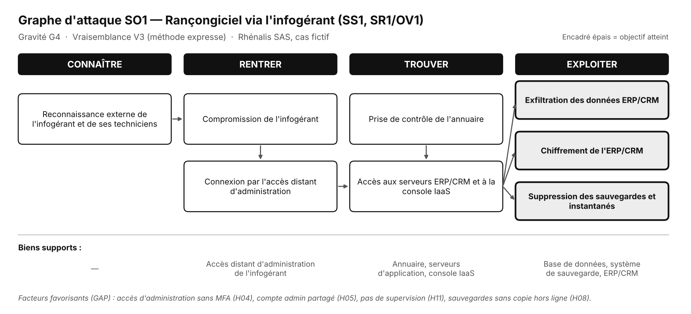
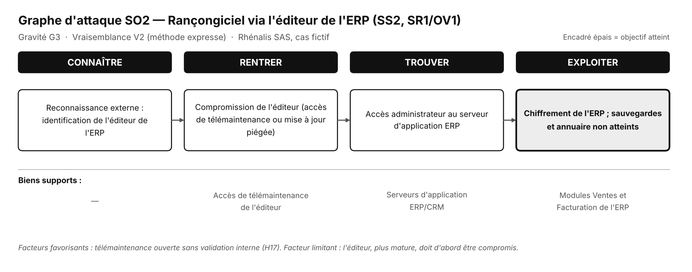
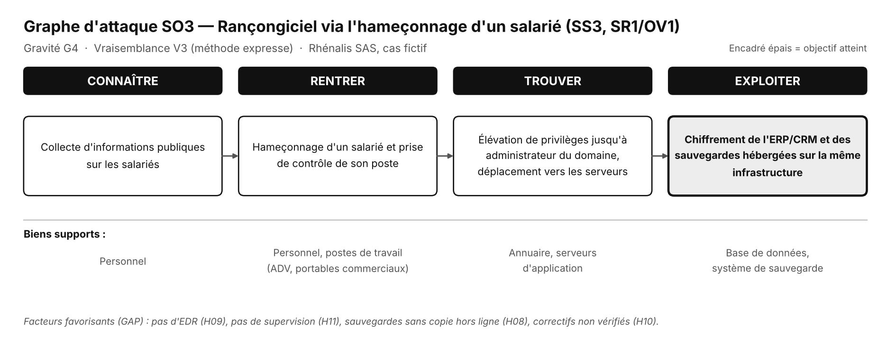
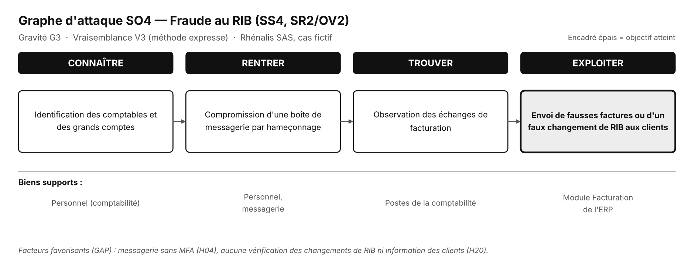
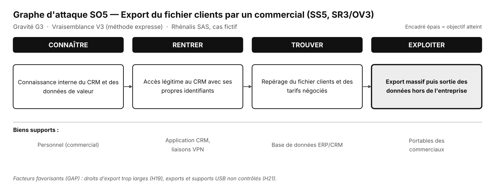

# A4 - Scénarios opérationnels

> **Atelier 4 - Étape 4.1 : Scénarios opérationnels**  
> Feuille du classeur : `Atelier 4 - SO` (+ support graphique `Atelier 4 - SO1`)  
> Dossier parent : [`README.md`](../README.md) · Fiche amont : [`03_atelier3_scenarios_strategiques/A3_scenarios_strategiques.md`](../03_atelier3_scenarios_strategiques/A3_scenarios_strategiques.md) · Fiche aval : [`A4_vraisemblance.md`](./A4_vraisemblance.md)

---

## 1. Identification

| Champ | Valeur |
|---|---|
| **Objet de l'étude** | Plateforme cloud hébergeant l'ERP et le CRM de Rhénalis SAS |
| **Atelier** | Atelier 4 - Scénarios opérationnels |
| **Étape** | 4.1 - Déclinaison des scénarios stratégiques en scénarios opérationnels |
| **Livrable** | Cinq scénarios opérationnels SO1 à SO5, structurés en 4 phases, avec biens supports et graphes d'attaque |
| **Statuts** | `[F]` fait établi · `[H]` hypothèse · `[M]` information manquante |

> **Rappel méthodologique** - Un **scénario opérationnel (SO)** décrit **comment** un scénario stratégique peut être réalisé concrètement, en structurant les actions de l'attaquant en **quatre phases** : **Connaître**, **Rentrer**, **Trouver**, **Exploiter**. Chaque phase est rattachée aux **biens supports** concernés. Les actions sont décrites au niveau **générique** attendu par la méthode : l'objectif de l'atelier est d'estimer la **vraisemblance** et de **situer les mesures**, non de documenter un mode opératoire détaillé.  
> Chaque SO est rattaché à un **scénario stratégique** (atelier 3), à un **couple SR/OV** (atelier 2) et à un **risque final** (atelier 5).

---

## 2. Vue d'ensemble

### 2.1 Tableau récapitulatif

| Code | SS associé | Couple SR/OV | Risque final | Gravité | Vraisemblance | Niveau initial |
|:-:|:-:|:-:|:-:|:-:|:-:|:-:|
| **SO1** | SS1 - rançongiciel via l'infogérant | SR1/OV1 | **R1** | G4 | **V3** - Très vraisemblable | 🔴 **Élevé** |
| **SO2** | SS2 - rançongiciel via l'éditeur | SR1/OV1 | **R2** | G3 | **V2** - Vraisemblable | 🟡 **Modéré** |
| **SO3** | SS3 - rançongiciel via hameçonnage d'un salarié | SR1/OV1 | **R3** | G4 | **V3** - Très vraisemblable | 🔴 **Élevé** |
| **SO4** | SS4 - fraude au RIB | SR2/OV2 | **R4** | G3 | **V3** - Très vraisemblable | 🟡 **Modéré** |
| **SO5** | SS5 - export du fichier clients | SR3/OV3 | **R5** | G3 | **V3** - Très vraisemblable | 🟡 **Modéré** |

> La cotation de la vraisemblance est justifiée dans [`A4_vraisemblance.md`](./A4_vraisemblance.md).

### 2.2 Lecture

- **Deux scénarios sont cotés V3 avec une gravité G4** : SO1 et SO3. Ce sont les deux scénarios qui portent les risques **élevés** (R1 et R3).
- **Un scénario est coté V2** : SO2. Le passage par l'éditeur, plus mature que l'infogérant, réduit la vraisemblance d'un niveau.
- **Trois scénarios sont directs** (SO3, SO4, SO5) : aucune partie prenante n'est compromise. Les mesures relèvent des biens supports.
- **Aucun scénario n'est coté V4** : comme le veut la méthode, la vraisemblance est évaluée **en supposant que la source de risque passe à l'acte**. Un scénario décidé est presque toujours réalisable ; ce sont les facteurs favorisants (GAP) qui font la différence entre V2 et V3.

---

## 3. Description détaillée des scénarios opérationnels

### 3.1 SO1 - Rançongiciel via l'infogérant

| Champ | Valeur |
|---|---|
| **Code** | SO1 |
| **SS associé** | SS1 |
| **Couple SR/OV** | SR1/OV1 - Organisation criminelle (rançongiciel) |
| **Risque final** | R1 |
| **Gravité** | 🔴 G4 |
| **Vraisemblance** | V3 - Très vraisemblable |
| **Niveau initial** | 🔴 Élevé |

#### Déroulement en 4 phases

| Phase | Action de l'attaquant | Bien support concerné |
|---|---|---|
| **Connaître** | Reconnaissance externe : identification de l'infogérant et de ses techniciens | - (information publique) |
| **Rentrer** | Compromission de l'infogérant (hameçonnage d'un technicien), puis connexion par son accès distant d'administration | Accès distant d'administration de l'infogérant |
| **Trouver** | Prise de contrôle de l'annuaire et des serveurs ERP/CRM | Annuaire, serveurs d'application, console IaaS |
| **Exploiter** | Exfiltration des données, chiffrement de l'ERP/CRM, suppression des sauvegardes et instantanés | Base de données, système de sauvegarde, console IaaS |

#### Graphe d'attaque

> Graphe détaillé également visible page 14 du dossier de synthèse. Encadré épais = objectif atteint.

#### Biens supports concernés

- Accès distant d'administration de l'infogérant
- Annuaire, serveurs d'application, console IaaS
- Base de données, système de sauvegarde, ERP/CRM

#### Facteurs favorisants (GAP de l'atelier 1)

| Code | Facteur |
|---|---|
| **GAP01** | Pas de MFA sur les accès distants d'administration (H04) |
| **GAP02** | Compte administrateur de domaine partagé (H05) |
| **GAP03** | Sauvegardes non testées, pas de copie hors ligne (H07, H08) |
| **GAP05** | Pas de supervision de sécurité (H11) |
| **GAP11** | Contrat d'infogérance sans clause de sécurité (H13) |

#### Mesures de traitement (atelier 5)

**Gouvernance** : M01 (avenant sécurité), M04 (vérification hébergeur).
**Protection** : M06 (MFA), M07 (bastion), M11 (durcissement annuaire).
**Défense** : M13 (supervision).
**Résilience** : M15 (sauvegarde immuable), M16 (PCA/PRA), M17 (cyber-assurance).

---

### 3.2 SO2 - Rançongiciel via l'éditeur de l'ERP

| Champ | Valeur |
|---|---|
| **Code** | SO2 |
| **SS associé** | SS2 |
| **Couple SR/OV** | SR1/OV1 - Organisation criminelle (rançongiciel) |
| **Risque final** | R2 |
| **Gravité** | 🟠 G3 |
| **Vraisemblance** | V2 - Vraisemblable |
| **Niveau initial** | 🟡 Modéré |

#### Déroulement en 4 phases

| Phase | Action de l'attaquant | Bien support concerné |
|---|---|---|
| **Connaître** | Reconnaissance externe : identification de l'éditeur de l'ERP | - (information publique) |
| **Rentrer** | Compromission de l'éditeur (accès de télémaintenance ou mise à jour piégée) | Accès de télémaintenance de l'éditeur |
| **Trouver** | Accès administrateur au serveur d'application ERP | Serveurs d'application ERP/CRM |
| **Exploiter** | Chiffrement de l'ERP ; sauvegardes et annuaire non atteints | Modules Ventes et Facturation de l'ERP |

#### Graphe d'attaque

> Graphe détaillé également visible page 14 du dossier de synthèse.

#### Biens supports concernés

- Accès de télémaintenance de l'éditeur
- Serveurs d'application ERP/CRM
- Modules Ventes et Facturation de l'ERP

#### Facteurs favorisants

| Code | Facteur |
|---|---|
| **GAP03** | Sauvegardes non testées (H07) |
| **GAP05** | Pas de supervision (H11) |
| **GAP07** | Pas de PCA/PRA (H12) |
| **H17** | Télémaintenance ouverte sans validation interne |

#### Facteur limitant

L'éditeur est **plus mature** que l'infogérant (maturité 3 contre 2) : il doit d'abord être compromis, ce qui réduit la vraisemblance à **V2**. La **pénétration reste à 3** : les droits d'administration sur le serveur demeurent.

#### Mesures de traitement

**Protection** : M07 (bastion), M08 (télémaintenance à la demande).
**Résilience** : M15 (sauvegarde immuable), M16 (PCA/PRA).

---

### 3.3 SO3 - Rançongiciel via l'hameçonnage d'un salarié

| Champ | Valeur |
|---|---|
| **Code** | SO3 |
| **SS associé** | SS3 |
| **Couple SR/OV** | SR1/OV1 - Organisation criminelle (rançongiciel) |
| **Risque final** | R3 |
| **Gravité** | 🔴 G4 |
| **Vraisemblance** | V3 - Très vraisemblable |
| **Niveau initial** | 🔴 Élevé |

#### Déroulement en 4 phases

| Phase | Action de l'attaquant | Bien support concerné |
|---|---|---|
| **Connaître** | Collecte d'informations publiques sur les salariés | Personnel |
| **Rentrer** | Hameçonnage d'un salarié et prise de contrôle de son poste | Personnel, postes de travail (ADV, portables commerciaux) |
| **Trouver** | Élévation de privilèges jusqu'à administrateur du domaine, déplacement vers les serveurs | Annuaire, serveurs d'application |
| **Exploiter** | Chiffrement de l'ERP/CRM et des sauvegardes hébergées sur la même infrastructure | Base de données, système de sauvegarde |

#### Graphe d'attaque

> Graphe détaillé également visible page 14 du dossier de synthèse.

#### Biens supports concernés

- Personnel
- Postes de travail (ADV, portables commerciaux)
- Liaisons VPN
- Annuaire, serveurs d'application
- Base de données, système de sauvegarde

#### Facteurs favorisants

| Code | Facteur |
|---|---|
| **GAP01** | Pas de MFA sur les accès distants (H04) |
| **GAP03** | Sauvegardes non testées, pas de copie hors ligne (H08) |
| **GAP04** | Pas d'EDR (H09) |
| **GAP05** | Pas de supervision (H11) |
| **GAP06** | Correctifs non vérifiés (H10) |
| **GAP07** | Pas de PCA/PRA (H12) |

#### Mesures de traitement

**Gouvernance** : M05 (sensibilisation hameçonnage).
**Protection** : M06 (MFA), M11 (durcissement annuaire), M19 (vérification correctifs).
**Défense** : M12 (EDR), M13 (supervision).
**Résilience** : M15 (sauvegarde immuable), M16 (PCA/PRA).

---

### 3.4 SO4 - Fraude au RIB

| Champ | Valeur |
|---|---|
| **Code** | SO4 |
| **SS associé** | SS4 |
| **Couple SR/OV** | SR2/OV2 - Organisation criminelle (fraude financière) |
| **Risque final** | R4 |
| **Gravité** | 🟠 G3 |
| **Vraisemblance** | V3 - Très vraisemblable |
| **Niveau initial** | 🟡 Modéré |

#### Déroulement en 4 phases

| Phase | Action de l'attaquant | Bien support concerné |
|---|---|---|
| **Connaître** | Identification des comptables et des grands comptes | Personnel (comptabilité) |
| **Rentrer** | Compromission d'une boîte de messagerie par hameçonnage | Personnel, messagerie |
| **Trouver** | Observation des échanges de facturation | Postes de la comptabilité |
| **Exploiter** | Envoi de fausses factures ou d'un faux changement de RIB aux clients | Module Facturation de l'ERP |

#### Graphe d'attaque

> Graphe détaillé également visible page 15 du dossier de synthèse.

#### Biens supports concernés

- Personnel (comptabilité)
- Messagerie
- Postes de la comptabilité
- Module Facturation de l'ERP

#### Facteurs favorisants

| Code | Facteur |
|---|---|
| **GAP01** | Pas de MFA sur la messagerie (H04) |
| **GAP13** | Aucune vérification des changements de RIB, clients jamais informés (H20) |

#### Point de vigilance

Les **grands comptes** sont les **victimes** de la fraude, et non un intermédiaire. Ils paient de bonne foi sur le compte de l'attaquant. C'est pourquoi la mesure **M10** (courrier aux grands comptes) porte sur la **confiance** et non sur la pénétration.

#### Mesures de traitement

**Gouvernance** : M05 (sensibilisation), M10 (courrier RIB).
**Protection** : M06 (MFA), M18 (double validation des RIB).
**Résilience** : M17 (cyber-assurance).

---

### 3.5 SO5 - Export du fichier clients par un commercial

| Champ | Valeur |
|---|---|
| **Code** | SO5 |
| **SS associé** | SS5 |
| **Couple SR/OV** | SR3/OV3 - Collaborateur malveillant (commercial sur le départ) |
| **Risque final** | R5 |
| **Gravité** | 🟠 G3 |
| **Vraisemblance** | V3 - Très vraisemblable |
| **Niveau initial** | 🟡 Modéré |

#### Déroulement en 4 phases

| Phase | Action de l'attaquant | Bien support concerné |
|---|---|---|
| **Connaître** | Connaissance interne du CRM et des données de valeur | Personnel (commercial) |
| **Rentrer** | Accès légitime au CRM avec ses propres identifiants | Application CRM, liaisons VPN |
| **Trouver** | Repérage du fichier clients et des tarifs négociés | Base de données ERP/CRM |
| **Exploiter** | Export massif puis sortie des données hors de l'entreprise | Portables des commerciaux |

#### Graphe d'attaque

> Graphe détaillé également visible page 15 du dossier de synthèse.

#### Biens supports concernés

- Personnel (commercial)
- Application CRM, liaisons VPN
- Base de données ERP/CRM
- Portables des commerciaux

#### Facteurs favorisants

| Code | Facteur |
|---|---|
| **GAP08** | Droits d'export trop larges (H19), exports et supports USB non contrôlés (H21) |

#### Point méthodologique

**Aucune effraction n'est nécessaire** : le commercial utilise ses droits légitimes. C'est pourquoi la vraisemblance est cotée **V3** : une fois décidé, il réussit presque à coup sûr. La méthode demande de coter **en supposant que la source de risque passe à l'acte**, ce qui est le cas ici.

#### Mesures de traitement

**Gouvernance** : M03 (registre RGPD).
**Protection** : M09 (restriction des exports, revue des droits, blocage USB).
**Défense** : M14 (alerte sur les exports volumineux).

---

## 4. Synthèse par phase

### 4.1 Répartition des phases

| Phase | Définition | Nombre d'actions décrites |
|:-:|---|:-:|
| **Connaître** | Reconnaissance, collecte d'informations | 5 |
| **Rentrer** | Accès initial au SI ou au tiers | 5 |
| **Trouver** | Mouvement latéral, élévation de privilèges, accès aux données | 5 |
| **Exploiter** | Atteinte de l'objectif : chiffrement, exfiltration, fraude | 5 |

> Chaque scénario comporte exactement **une action par phase**. C'est le format attendu par la fiche méthode de l'ANSSI et par le classeur.

### 4.2 Biens supports transverses

| Bien support | SO concernés | Rôle |
|---|:-:|---|
| **Annuaire** | SO1, SO3 | Cible de prise de contrôle, point de passage vers les serveurs |
| **Système de sauvegarde** | SO1, SO3 | Cible de destruction ou de chiffrement |
| **Base de données** | SO1, SO3, SO5 | Cible d'exfiltration ou de chiffrement |
| **Personnel** | SO3, SO4, SO5 | Point d'entrée (hameçonnage) ou source de menace interne |
| **Messagerie** | SO4 | Vecteur de compromission et de fraude |
| **Console IaaS** | SO1 | Point de suppression des sauvegardes |

> Quatre biens supports sont **transverses** à plusieurs scénarios : l'annuaire, la base de données, les sauvegardes et le personnel. Ce sont les cibles prioritaires des mesures du PTR.

---

## 5. Correspondance avec le classeur EBIOS RM

| Élément de cette fiche | Feuille du classeur | Colonnes |
|---|---|---|
| Codes SO1 à SO5 | `Atelier 4 - SO` | Colonne A |
| Vraisemblance globale | `Atelier 4 - SO` | Colonne B |
| Phases et biens supports | `Atelier 4 - SO` | Colonne A (texte multi-lignes) |
| Support graphique SO1 | `Atelier 4 - SO1` | Feuille vide |
| Risques finaux | `Atelier 5 - Risques` | Colonnes A à L |

> La feuille `Atelier 4 - SO` regroupe, pour chaque scénario, les quatre phases et les biens supports dans une seule cellule. Les graphes d'attaque sont des **supports graphiques séparés**, produits à partir des fiches méthode de l'ANSSI.

---

## 6. Checklist de validation

- [x] Les **5 scénarios opérationnels** de la feuille `Atelier 4 - SO` sont repris et décrits.
- [x] Chaque SO est relié à un **scénario stratégique** de l'atelier 3.
- [x] Chaque SO couvre les **4 phases** : Connaître, Rentrer, Trouver, Exploiter.
- [x] Chaque phase cite les **biens supports** concernés, tels qu'ils sont recensés dans la feuille `Missions`.
- [x] Les **facteurs favorisants** (GAP de l'atelier 1) sont cités pour chaque SO.
- [x] Les **mesures du PTR** sont rattachées à chaque SO.
- [x] Les scénarios **directs** (SO3, SO4, SO5) sont distingués des scénarios passant par un tiers (SO1, SO2).
- [x] Le rôle des **grands comptes comme victimes** dans SO4 est explicité.
- [x] La **vraisemblance** est cohérente avec la cotation de `A4_vraisemblance.md`.
- [x] Les **graphes d'attaque** sont produits pour les 5 scénarios.
- [x] Les scénarios sont **cohérents avec les risques R1 à R5** de l'atelier 5.

---

## 7. Références

- ANSSI - *EBIOS Risk Manager*, fiche méthode « Scénarios opérationnels » (atelier 4).
- MITRE ATT&CK - cadre de référence pour les techniques d'attaque : `attack.mitre.org`.
- Classeur modèle `EBIOS_RM_Ateliers_modele.xlsx` - feuilles `Atelier 4 - SO`, `Atelier 4 - SO1`.
- Dossier de synthèse - § 6 « Atelier 4 - Scénarios opérationnels et vraisemblance » (pages 13-15).
- Fiche amont : [`03_atelier3_scenarios_strategiques/A3_scenarios_strategiques.md`](../03_atelier3_scenarios_strategiques/A3_scenarios_strategiques.md).
- Fiche aval : [`A4_vraisemblance.md`](./A4_vraisemblance.md).