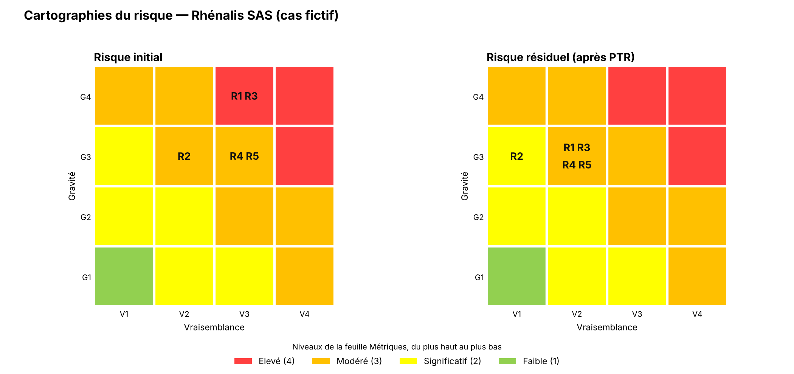

# A5 - Synthèse des risques

> **Atelier 5 - Étape 5.1 : Synthèse des risques**  
> Feuille du classeur : `Atelier 5 - Risques` (+ `Risques résiduels`)  
> Dossier parent : [`README.md`](../README.md) · Fiche amont : [`04_atelier4_scenarios_operationnels/A4_vraisemblance.md`](../04_atelier4_scenarios_operationnels/A4_vraisemblance.md) · Fiches associées : [`A5_PTR.md`](./A5_PTR.md), [`A5_risques_residuels.md`](./A5_risques_residuels.md)

---

## 1. Identification

| Champ | Valeur |
|---|---|
| **Objet de l'étude** | Plateforme cloud hébergeant l'ERP et le CRM de Rhénalis SAS |
| **Atelier** | Atelier 5 - Traitement du risque |
| **Étape** | 5.1 - Synthèse des risques et niveau de risque initial |
| **Livrable** | Cinq risques R1 à R5, agrégés depuis les ateliers 1 à 4, cotés en gravité et vraisemblance, avec stratégie de traitement |
| **Statuts** | `[F]` fait établi · `[H]` hypothèse · `[M]` information manquante |

> **Rappel méthodologique** - Un **risque** agrège une source de risque, un objectif visé, un événement redouté, un scénario stratégique et un scénario opérationnel. Son **niveau** est obtenu par croisement de la **gravité** (atelier 1) et de la **vraisemblance** (atelier 4) selon la matrice de la feuille `Métriques`. L'atelier 5 décide ensuite de la **stratégie de traitement** : réduire, accepter, éviter ou transférer.

---

## 2. Échelles et matrice de risque

### 2.1 Gravité (rappel - feuille `Métriques`)

| Niveau | Définition |
|:-:|---|
| **G4** | Survie de l'organisation menacée |
| **G3** | Mode très dégradé, sérieuses difficultés |
| **G2** | Mode dégradé, quelques difficultés |
| **G1** | Conséquences négligeables |

### 2.2 Vraisemblance (rappel - feuille `Métriques`)

| Niveau | Définition |
|:-:|---|
| **V4** | Quasi-certain |
| **V3** | Probable |
| **V2** | Susceptible |
| **V1** | Peu vraisemblable |

### 2.3 Niveaux de risque (feuille `Métriques`)

| Niveau | Valeur | Signification |
|:-:|:-:|---|
| 🔴 **Élevé** | 4 | Risque inacceptable en l'état |
| 🟡 **Modéré** | 3 | Risque à traiter |
| 🟢 **Significatif** | 2 | Risque tolérable sous surveillance |
| ⚪ **Faible** | 1 | Risque acceptable |

> **Attention à la lecture** : sur l'échelle du classeur, **« Significatif » (2) est plus bas que « Modéré » (3)**. Un risque qui passe de « Modéré » à « Significatif » s'améliore.

### 2.4 Matrice de risque (feuille `Métriques`)

| Gravité \ Vraisemblance | **V1** | **V2** | **V3** | **V4** |
|:-:|:-:|:-:|:-:|:-:|
| **G4** | Modéré | Élevé | Élevé | Élevé |
| **G3** | Significatif | Modéré | Élevé | Élevé |
| **G2** | Faible | Significatif | Modéré | Modéré |
| **G1** | Faible | Faible | Significatif | Significatif |

---

## 3. Tableau de synthèse des risques

| Index | Risque | Sources de risque | Objectifs visés | Événements redoutés | Scénarios stratégiques | Chemin d'attaque | Gravité | Scénarios opérationnels | Vraisemblance | Niveau initial | Traitement |
|:-:|---|---|---|---|---|:-:|:-:|:-:|:-:|:-:|:-:|
| **R1** | Un groupe cybercriminel provoque la perte définitive des données de gestion de Rhénalis, en passant par l'infogérant, afin d'exiger une rançon. | SR1 | OV1 | Perte définitive des données comptables (G4) | SS1 | via l'infogérant | **4** | SO1 | **3** | 🔴 **Élevé** | **Réduire** |
| **R2** | Un groupe cybercriminel rend l'ERP indisponible plus d'une semaine, en passant par l'éditeur du logiciel, afin d'exiger une rançon. | SR1 | OV1 | Prise de commandes impossible > 1 semaine (G3) | SS2 | via l'éditeur | **3** | SO2 | **2** | 🟡 **Modéré** | **Réduire** |
| **R3** | Un groupe cybercriminel provoque la perte définitive des données de gestion, à partir du poste d'un salarié piégé par un courriel, afin d'exiger une rançon. | SR1 | OV1 | Perte définitive des données comptables (G4) | SS3 | chemin direct (salarié) | **4** | SO3 | **3** | 🔴 **Élevé** | **Réduire** |
| **R4** | Un fraudeur détourne des paiements de clients vers son propre compte en se faisant passer pour Rhénalis auprès des grands comptes. | SR2 | OV2 | Modification frauduleuse du RIB (G3) | SS4 | chemin direct (messagerie) | **3** | SO4 | **3** | 🟡 **Modéré** | **Réduire** |
| **R5** | Un commercial sur le départ emporte le fichier clients et les tarifs négociés pour les utiliser chez un concurrent. | SR3 | OV3 | Vol et divulgation du fichier clients (G3) | SS5 | chemin direct (accès légitime) | **3** | SO5 | **3** | 🟡 **Modéré** | **Réduire** |

> Les colonnes « Gravité » et « Vraisemblance » sont les valeurs numériques de la feuille `Atelier 5 - Risques` (4 = G4, 3 = V3, etc.). Le niveau initial est calculé par la matrice.

---

## 4. Description détaillée des risques

### 4.1 R1 - Perte définitive des données via l'infogérant

| Champ | Valeur |
|---|---|
| **Code** | R1 |
| **Source de risque** | SR1 - Organisation criminelle (rançongiciel) |
| **Objectif visé** | OV1 - Gain financier par rançon et double extorsion |
| **Événement redouté** | ER6 - Perte définitive des données comptables et de gestion (G4) |
| **Scénario stratégique** | SS1 - Compromission de l'infogérant, puis de la console IaaS |
| **Scénario opérationnel** | SO1 - Rançongiciel via l'infogérant |
| **Gravité** | 4 (G4) |
| **Vraisemblance** | 3 (V3) |
| **Niveau initial** | 🔴 **Élevé** |
| **Traitement** | **Réduire** |

**Justification du niveau** : la perte définitive des données comptables menace la survie de l'entreprise (G4). La vraisemblance est V3 car l'infogérant est en **zone danger** (indice 4,00) et quatre écarts du socle favorisent le scénario : GAP01 (pas de MFA), GAP02 (compte admin partagé), GAP05 (pas de supervision), GAP11 (contrat sans clause de sécurité). La chaîne passe par un tiers critique, sans barrière technique.

**Mesures de traitement** : M01 (avenant sécurité), M04 (vérification hébergeur), M06 (MFA), M07 (bastion), M11 (durcissement annuaire), M13 (supervision), M15 (sauvegarde immuable), M16 (PCA/PRA), M17 (cyber-assurance).

---

### 4.2 R2 - ERP indisponible via l'éditeur

| Champ | Valeur |
|---|---|
| **Code** | R2 |
| **Source de risque** | SR1 - Organisation criminelle (rançongiciel) |
| **Objectif visé** | OV1 - Gain financier par rançon |
| **Événement redouté** | ER1 - Prise de commandes impossible > 1 semaine (G3) |
| **Scénario stratégique** | SS2 - Compromission de l'éditeur de l'ERP |
| **Scénario opérationnel** | SO2 - Rançongiciel via l'éditeur |
| **Gravité** | 3 (G3) |
| **Vraisemblance** | 2 (V2) |
| **Niveau initial** | 🟡 **Modéré** |
| **Traitement** | **Réduire** |

**Justification du niveau** : l'indisponibilité de l'ERP au-delà d'une semaine provoque l'arrêt de 70 % du CA, mais l'entreprise survit avec de sérieuses difficultés (G3). La vraisemblance est V2 car l'éditeur est en **zone contrôle** (indice 1,33), plus mature (maturité 3) et n'accède au serveur qu'à la demande (H17), contrairement à l'infogérant.

**Mesures de traitement** : M07 (bastion), M08 (télémaintenance à la demande), M15 (sauvegarde immuable), M16 (PCA/PRA).

---

### 4.3 R3 - Perte définitive des données via un salarié

| Champ | Valeur |
|---|---|
| **Code** | R3 |
| **Source de risque** | SR1 - Organisation criminelle (rançongiciel) |
| **Objectif visé** | OV1 - Gain financier par rançon et double extorsion |
| **Événement redouté** | ER6 - Perte définitive des données comptables et de gestion (G4) |
| **Scénario stratégique** | SS3 - Hameçonnage d'un salarié, puis élévation de privilèges |
| **Scénario opérationnel** | SO3 - Rançongiciel via hameçonnage d'un salarié |
| **Gravité** | 4 (G4) |
| **Vraisemblance** | 3 (V3) |
| **Niveau initial** | 🔴 **Élevé** |
| **Traitement** | **Réduire** |

**Justification du niveau** : même événement redouté que R1 (perte définitive des données, G4). La vraisemblance est V3 car environ 75 utilisateurs sont exposés, sans EDR (GAP04), sans supervision (GAP05), avec des sauvegardes non testées (GAP03) et des correctifs non vérifiés (GAP06). Le chemin est direct, sans tiers à compromettre.

**Mesures de traitement** : M05 (sensibilisation), M06 (MFA), M11 (durcissement annuaire), M12 (EDR), M13 (supervision), M15 (sauvegarde immuable), M16 (PCA/PRA), M19 (vérification correctifs).

---

### 4.4 R4 - Fraude au RIB

| Champ | Valeur |
|---|---|
| **Code** | R4 |
| **Source de risque** | SR2 - Organisation criminelle (fraude financière) |
| **Objectif visé** | OV2 - Détourner les paiements clients |
| **Événement redouté** | ER5 - Modification frauduleuse du RIB (G3) |
| **Scénario stratégique** | SS4 - Compromission d'une messagerie, fausse facture ou faux RIB |
| **Scénario opérationnel** | SO4 - Fraude au RIB |
| **Gravité** | 3 (G3) |
| **Vraisemblance** | 3 (V3) |
| **Niveau initial** | 🟡 **Modéré** |
| **Traitement** | **Réduire** |

**Justification du niveau** : la fraude peut détourner plusieurs centaines de k€ avant détection, avec des pertes souvent irrécupérables (G3). La vraisemblance est V3 car la messagerie est sans MFA (GAP01), les changements de RIB ne sont pas vérifiés (GAP13), les clients ne sont pas informés, et un hameçonnage a déjà réussi en 2025 (H15). Les grands comptes sont les **victimes**, pas un intermédiaire.

**Mesures de traitement** : M05 (sensibilisation), M06 (MFA), M10 (courrier aux grands comptes), M17 (cyber-assurance), M18 (double validation des RIB).

---

### 4.5 R5 - Départ d'un commercial avec le fichier clients

| Champ | Valeur |
|---|---|
| **Code** | R5 |
| **Source de risque** | SR3 - Collaborateur malveillant (commercial sur le départ) |
| **Objectif visé** | OV3 - Emporter le fichier clients et les tarifs |
| **Événement redouté** | ER3 - Vol et divulgation du fichier clients (G3) |
| **Scénario stratégique** | SS5 - Export massif via les droits légitimes du commercial |
| **Scénario opérationnel** | SO5 - Export du fichier clients par un commercial |
| **Gravité** | 3 (G3) |
| **Vraisemblance** | 3 (V3) |
| **Niveau initial** | 🟡 **Modéré** |
| **Traitement** | **Réduire** |

**Justification du niveau** : la divulgation du fichier clients expose des données personnelles (RGPD) et des tarifs négociés, avec une atteinte durable à la position commerciale (G3). La vraisemblance est V3 car le scénario ne nécessite aucune effraction : le commercial utilise ses droits légitimes, avec des exports trop larges et aucun contrôle des supports USB (GAP08). Une fois décidé, il réussit presque à coup sûr.

**Mesures de traitement** : M03 (registre RGPD), M09 (restriction des exports, revue des droits, blocage USB), M14 (alerte sur les exports volumineux).

---

## 5. Analyse des niveaux de risque initiaux

### 5.1 Répartition par niveau

| Niveau | Nombre de risques | Codes | Poids |
|:-:|:-:|:-:|:-:|
| 🔴 **Élevé** | **2** | R1, R3 | **40 %** |
| 🟡 **Modéré** | **3** | R2, R4, R5 | **60 %** |
| 🟢 **Significatif** | 0 | - | 0 % |
| ⚪ **Faible** | 0 | - | 0 % |

### 5.2 Les deux risques élevés

**R1 et R3 partagent le même événement redouté** : la perte définitive des données comptables et de gestion (ER6, G4). Ils diffèrent par le chemin d'attaque :

- **R1** passe par l'infogérant (SS1), tiers en zone danger ;
- **R3** passe par un salarié (SS3), chemin direct.

**Les deux reposent sur les mêmes faiblesses** : absence de MFA (GAP01), compte administrateur partagé (GAP02, pour R1), sauvegardes non testées et sans copie hors ligne (GAP03), absence de supervision (GAP05). Ces faiblesses sont des **hypothèses de travail**, à vérifier en priorité.

**La mesure M15 (sauvegarde immuable externalisée et testée) est la mesure clé** : elle fait passer la gravité de R1 et R3 de G4 à G3, car la perte définitive des données n'est plus atteignable. C'est le principal levier de réduction.

### 5.3 Les trois risques modérés

- **R2** (ERP indisponible via l'éditeur) est le seul coté **V2** : le tiers traversé (l'éditeur) est plus mature et n'accède au serveur qu'à la demande.
- **R4** (fraude au RIB) et **R5** (export du fichier clients) sont cotés **V3** : les facteurs favorisants sont présents, et les mesures sont à déployer.

> **Aucun risque n'est accepté en l'état.** Les deux risques élevés engagent la continuité de l'activité ; les trois risques modérés portent sur des pertes financières ou des données personnelles. Aucun ne peut être **évité**, puisque la plateforme ERP/CRM est indispensable à l'activité. Le **transfert** (cyber-assurance, M17) n'est envisagé qu'en **complément**, pour la part financière résiduelle.

---

## 6. Stratégie de traitement

| Risque | Stratégie | Justification |
|:-:|---|---|
| **R1** | **Réduire** | Risque élevé, menace la survie. Réduction par M01, M06, M07, M11, M13, M15, M16. |
| **R2** | **Réduire** | Risque modéré, mais impact fort sur l'activité. Réduction par M07, M08, M15, M16. |
| **R3** | **Réduire** | Risque élevé, menace la survie. Réduction par M05, M06, M11, M12, M13, M15, M16, M19. |
| **R4** | **Réduire** | Risque modéré, pertes financières non récupérables. Réduction par M05, M06, M10, M18 ; transfert partiel par M17. |
| **R5** | **Réduire** | Risque modéré, atteinte à la position commerciale. Réduction par M03, M09, M14. |

> **Aucune stratégie d'acceptation en l'état** : les risques résiduels seront acceptés **après** mise en œuvre du PTR, et explicitement par la direction (cf. [`A5_risques_residuels.md`](./A5_risques_residuels.md)).

---

## 7. Aperçu des risques résiduels

> Le détail est traité dans [`A5_risques_residuels.md`](./A5_risques_residuels.md). Cette section ne donne que la synthèse.

| Risque | Gravité initiale | Vraisemblance initiale | Niveau initial | Mesures | Gravité résiduelle | Vraisemblance résiduelle | Niveau résiduel |
|:-:|:-:|:-:|:-:|:-:|:-:|:-:|:-:|
| **R1** | G4 | V3 | 🔴 Élevé | M01, M04, M06, M07, M11, M13, M15, M16, M17 | G3 | V2 | 🟡 **Modéré** |
| **R2** | G3 | V2 | 🟡 Modéré | M07, M08, M15, M16 | G3 | V1 | 🟢 **Significatif** |
| **R3** | G4 | V3 | 🔴 Élevé | M05, M06, M11, M12, M13, M15, M16, M19 | G3 | V2 | 🟡 **Modéré** |
| **R4** | G3 | V3 | 🟡 Modéré | M05, M06, M10, M17, M18 | G3 | V2 | 🟡 **Modéré** |
| **R5** | G3 | V3 | 🟡 Modéré | M03, M09, M14 | G3 | V2 | 🟡 **Modéré** |

**Lecture** :
- **R1 et R3 passent de G4 à G3** grâce à la sauvegarde immuable testée (M15) : la perte définitive des données n'est plus atteignable.
- **R2 passe de V2 à V1** : la télémaintenance encadrée (M08) et la sauvegarde immuable (M15) réduisent la vraisemblance.
- **R4 et R5 restent modérés** : les mesures réduisent la vraisemblance sans la supprimer (le client paie, le commercial a un accès légitime).

---

## 8. Correspondance avec le classeur EBIOS RM

| Élément de cette fiche | Feuille du classeur | Colonnes |
|---|---|---|
| Index R1 à R5 | `Atelier 5 - Risques` | Colonne A |
| Description du risque | `Atelier 5 - Risques` | Colonne B |
| Niveau de risque | `Atelier 5 - Risques` | Colonne C |
| Traitement | `Atelier 5 - Risques` | Colonne D |
| Source de risque | `Atelier 5 - Risques` | Colonne E |
| Objectif visé | `Atelier 5 - Risques` | Colonne F |
| Événement redouté | `Atelier 5 - Risques` | Colonne G |
| Scénario stratégique | `Atelier 5 - Risques` | Colonne H |
| Chemin d'attaque | `Atelier 5 - Risques` | Colonne I |
| Gravité | `Atelier 5 - Risques` | Colonne J |
| Scénario opérationnel | `Atelier 5 - Risques` | Colonne K |
| Vraisemblance | `Atelier 5 - Risques` | Colonne L |
| Risques résiduels | `Risques résiduels` | Colonnes A à I |

---

## 9. Checklist de validation

- [x] Les **cinq risques** R1 à R5 de la feuille `Atelier 5 - Risques` sont repris.
- [x] Chaque risque agrège **SR, OV, ER, SS, SO, gravité et vraisemblance**.
- [x] Le **niveau initial** est cohérent avec la matrice de la feuille `Métriques`.
- [x] Les **deux risques élevés** (R1, R3) sont identifiés et justifiés.
- [x] Les **trois risques modérés** (R2, R4, R5) sont identifiés et justifiés.
- [x] La **stratégie de traitement** est explicite : **réduire** pour les cinq risques.
- [x] Les **mesures du PTR** sont rattachées à chaque risque.
- [x] L'**absence d'acceptation en l'état** est rappelée.
- [x] Le **transfert** (cyber-assurance) est présenté comme complément, non comme stratégie principale.
- [x] L'**aperçu des risques résiduels** est cohérent avec `A5_risques_residuels.md`.
- [x] Les risques sont **cohérents avec les scénarios stratégiques et opérationnels** des ateliers 3 et 4.
- [x] Le tableau est **cohérent avec la feuille `Atelier 5 - Risques`** du classeur.

---

## 10. Références

- ANSSI - *EBIOS Risk Manager*, fiche méthode « Synthèse des risques » (atelier 5).
- Classeur modèle `EBIOS_RM_Ateliers_modele.xlsx` - feuilles `Atelier 5 - Risques`, `Risques résiduels`, `Métriques`.
- Dossier de synthèse - § 7.1 « Synthèse des risques » (page 16).
- Fiche amont : [`04_atelier4_scenarios_operationnels/A4_vraisemblance.md`](../04_atelier4_scenarios_operationnels/A4_vraisemblance.md).
- Fiches associées : [`A5_PTR.md`](./A5_PTR.md), [`A5_risques_residuels.md`](./A5_risques_residuels.md), [`A5_cadre_suivi.md`](./A5_cadre_suivi.md).